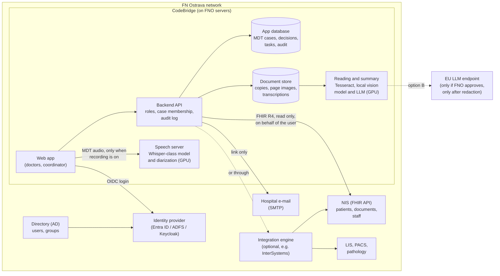

# Integration with the hospital - CodeBridge

How CodeBridge would connect to FN Ostrava's systems in a pilot: who the
user is, which patients and documents the app sees, who may see what, and
where it runs. This is the design the demo points to; the demo itself
implements none of it (see [What the demo shows](#what-the-demo-shows)).
Backlog item 2 in [`BACKLOG.md`](BACKLOG.md) adds live research with
sources on top of this design. Points marked *assumption* are not yet
confirmed by FNO; they are repeated in [Questions for FNO](#questions-for-fno).

Terms used here:

- **NIS** (nemocniční informační systém): the hospital information
  system, which holds the medical record. FNO's NIS supports FHIR
  ([`docs/agent/INDEX.md`](../agent/INDEX.md)).
- **FHIR R4**: the HL7 standard for exchanging health records as linked
  JSON records called resources. That FNO exposes R4 is an *assumption*.
- **Directory**: the hospital's user directory, usually Microsoft Active
  Directory (AD), often synced to Microsoft Entra ID.
- **Identity provider (IdP)**: the service that runs the login page and
  issues tokens: Entra ID, or for an on-premises AD a server in front of
  it such as ADFS or Keycloak. AD itself does not speak OIDC.
- **OIDC** (OpenID Connect): the login protocol. The app sends the user to
  the IdP's login page and gets back a signed token saying who they are
  and which roles or groups they have.

## Architecture

Three sources, three kinds of data:

| Source | What it gives | How we connect |
|---|---|---|
| Directory, through the IdP | Who is logged in, their roles or groups | OIDC login |
| NIS, directly or through the hospital's integration engine (for example InterSystems), whichever FNO uses for other apps | Patients, their documents and results, staff as clinical roles (who referred, who treats) | FHIR R4, read only |
| CodeBridge's own database | MDT cases, who is on each case, protocols and decisions, tasks, audit log | Our backend API |

The directory and the NIS are different systems with different data. They
meet on one identifier: the same doctor is a user in the directory and a
staff member (FHIR `Practitioner`) in the NIS. *Assumption*: the two are
linked by the staff number or login. That link is what lets the app say
"the logged-in user is MUDr. X, who referred this patient".

## Who the user is: login and roles

- **No own passwords or user database.** The app logs users in through
  the hospital's IdP with OIDC. Two-factor login follows the hospital's
  policy.
- **Tokens stay on the server.** The backend is a confidential OIDC client
  (authorization code flow with PKCE); it checks the token's issuer,
  audience and nonce, keeps tokens on the server, and gives the browser
  only an HttpOnly session cookie. Sessions are short and re-checked with
  the IdP, so a disabled account loses access within minutes, not at the
  next login.
- **The hospital keeps the users and groups.** IT creates accounts and
  adds people to groups as part of hiring and leaving.
- **Roles are ours, mapped from the IdP.** With Entra ID the cleanest way
  is app roles: FNO assigns hospital groups to CodeBridge's roles in Entra,
  and the token carries a `roles` claim. (Group claims carry group IDs,
  not names, and stop listing them for users in very many groups, so the
  app would map by ID.) The group names below are examples until FNO names
  its own:

| Hospital group (example) | CodeBridge role | May do |
|---|---|---|
| `MDT-NeuroOnko-Lekari` | Doctor | Open cases they are a member of; edit and confirm summaries, conclusions and tasks |
| `MDT-NeuroOnko-Koordinatori` | Coordinator | Create cases, schedule, request documents, see task status; no clinical edits |
| `CodeBridge-Spravci` | Administrator | Configuration and the audit log; no clinical content |

The entities, and where each lives:

| Entity | Lives in | Notes |
|---|---|---|
| User | Directory | Name, login, department, staff number |
| Group | Directory | Departments, professions, teams |
| Role | CodeBridge configuration, assigned in the IdP | What each role may do |
| Staff member (`Practitioner`, `PractitionerRole`) | NIS | Clinical role and department; linked to the user |
| Patient (`Patient`) | NIS | Identified by the hospital patient ID; the birth number only where shown |
| MDT case and case membership | CodeBridge | Which doctors and departments belong to a patient's MDT case |
| Delegation | CodeBridge | A coordinator preparing a case for a named doctor, recorded in the audit log |
| Audit entry | CodeBridge | Who opened or changed what, when; append only |

## Who may see which patient

- **Role plus case membership.** Being a doctor is not enough; the doctor
  must be a member of the patient's MDT case (the referring doctor, the
  departments at the MDT, or someone added by the coordinator). Directory
  groups are too coarse for this, so membership lives in CodeBridge.
- **The NIS's own rules still apply.** The backend reads FHIR on behalf
  of the logged-in user (the user's token passed on, or the user named on
  each call), never as an anonymous service account that sees everything.
  That keeps the NIS's access checks and its own audit trail, which Czech
  law expects at every access to the record
  ([`docs/agent/INDEX.md`](../agent/INDEX.md#czech-legal-frame)). How
  FNO's FHIR endpoint supports this is an open question. If only a service
  account is possible, it is limited to read-only access to the resources
  below, over mutual TLS, and CodeBridge's audit log becomes the only
  record of who saw what.
- **Break the glass.** A doctor who is not a member can still open a
  case in an emergency after giving a reason. The access is logged and
  goes to the person FNO names for review (for example the data
  protection officer or the department head); the administrator role
  sees only that it happened, not the clinical content.
- **Audit log.** Every opening of a case, every source viewed, and every
  change is logged with user, time, and case. Entries are append only.
  Only the administrator and the data protection officer read it. How long
  it is kept is for FNO to set.
- **Least data.** Screens, exports and notifications carry only what
  their task needs. E-mails to the coordinator carry a link, never medical
  data (`CLAUDE.md`, "Patient data and privacy").

## Patient data in and out

- **The doctor starts from the NIS.** The usual entry is a link from the
  patient's record in the NIS to the patient's case in CodeBridge. Two
  ways, depending on what FNO's NIS supports:
  - **SMART on FHIR launch** (the standard for launching an app from the
    record over OAuth2): the NIS's own authorization server issues a token
    for the FHIR API and returns the current patient (`patient`) and user
    (`fhirUser`) with it. The user is then known to two systems, the IdP
    and the NIS; the app checks that the `fhirUser` belongs to the
    logged-in IdP user before opening the case.
  - **Plain link**: the NIS opens CodeBridge with the hospital patient ID;
    the user logs in through OIDC and the app opens that patient.
- **Patient identity is never guessed.** Czech hospitals hold duplicate
  records for one birth number. The app keys on the NIS patient ID,
  follows merges the NIS reports (`Patient.link`), and shows a warning
  when documents disagree on who the patient is (`CLAUDE.md`, "Do not
  merge patients silently"). A document uploaded by hand is assigned to a
  patient by the user, with the name and birth number on the document
  checked against the record; national lookups (IHE PIXm/PDQm) stay
  visible stubs.
- **Reading the record over FHIR.** Read only, using the Czech core
  profiles (hl7.cz, pinned in [`docs/agent/INDEX.md`](../agent/INDEX.md#standards-we-follow))
  where FNO's API follows them, and keeping the codes the source gives:

| What | FHIR R4 resource |
|---|---|
| Patient identity | `Patient` |
| Documents (reports, discharge letters, scans) | `DocumentReference`, with the file as `Binary`; IHE MHD (the standard API to find and fetch documents) where offered |
| Lab results | `Observation`, `DiagnosticReport`, with NČLP codes kept |
| Diagnoses and stage | `Condition`, `Observation`, with MKN-10 codes kept |
| Histology and imaging | `DiagnosticReport`, `Specimen`, `ImagingStudy` |
| Treatment | `Procedure`, `MedicationRequest`, `MedicationStatement`, `MedicationAdministration`, `CarePlan` |
| Visits and hospital stays | `Encounter` |
| Referrals, including ones with no result yet, and the MDT request | `ServiceRequest` |
| Referring doctor, departments | `Practitioner`, `PractitionerRole`, `Organization` |

  How our outputs map to these is in
  [`docs/agent/INDEX.md`](../agent/INDEX.md#required-outputs-and-how-to-model-them).
- **Copies are kept only as long as the case needs them.** The document
  store holds copies of NIS documents, their page images and
  transcriptions, encrypted at rest. *Proposed default*, for FNO to
  confirm: kept while the MDT case is open plus a set period after the
  last MDT decision, then deleted; the decisions and the audit log follow
  FNO's record-keeping rules. When the NIS marks a document as replaced or
  corrected (`DocumentReference.status`, `relatesTo`), the app reads the
  new version and flags facts that came from the old one; facts a doctor
  confirmed never change silently.
- **Documents uploaded by hand** (from other hospitals) go into the same
  store and reading pipeline; backlog item 4 designs that.
- **Nothing is written back into the record.** The record legally
  belongs to the provider; CodeBridge's summaries, drafts and decisions
  stay in its own database. The app does not file anything into the NIS.
  If FNO wants the approved MDT protocol in the record, filing the
  exported PDF is the doctor's own act under FNO's rules; an automatic
  interface would be a separate decision by FNO.

## Deployment

- **On FNO's servers**, inside the hospital network, behind the
  hospital's login, in the network zone FNO uses for clinical
  applications. No patient data leaves the network by default.
- **A GPU server for the local models**: the vision model that reads
  scanned pages, and the language model that extracts facts and writes
  the summary (option A in [`DATA-PROTECTION.md`](DATA-PROTECTION.md)).
  A cloud model is used only through an FNO-approved EU endpoint, and
  only after local redaction and pseudonymization, with the mapping back
  to the patient kept on FNO's servers (option B).
- **Operations**: backups of the app database and document store,
  monitoring, logs without patient text by default, e-mail through the
  hospital's mail server.
- **Rules that apply**: GDPR and the Czech health-records law (see
  [`docs/agent/INDEX.md`](../agent/INDEX.md#czech-legal-frame)), FNO's
  obligations under the Czech cybersecurity law (the act implementing
  the EU NIS2 directive; which act and category apply is for backlog item
  2 to check), and possibly the EU medical device regulation (MDR),
  because the app summarizes records for clinical decisions. These are for
  backlog item 2's research and FNO's legal team.

## What the demo shows

The demo runs on our Cloudflare Worker with fictitious data and no
connection to FNO. During the hackathon it had no login, as the
InterSystems mentors advised against spending hackathon time on OAuth
(FHIR workshop, rec2 02:04:31, in
[`docs/research/2026-10-16-talk-fhir-workshop-and-phoenix.md`](../research/2026-10-16-talk-fhir-workshop-and-phoenix.md));
the login came after it ([`AUTH.md`](AUTH.md)). What the demo shows,
and what each stands for:

| In the demo | Stands for |
|---|---|
| OIDC login at Zitadel (EU) with roles from our own memberships, an account menu and, in a demo org, "Přepnout roli" logged with the real person ([`AUTH.md`](AUTH.md)); the user picker only in local demo mode | OIDC login at the hospital's IdP (Entra ID or its own), with the IdP's roles mapped onto memberships |
| Different screens per role (Administrace only for the administrator) | Role checks in the backend |
| Access log in Administrace | The audit log |
| Fictitious PDFs read by Tesseract and a vision model | Documents from the NIS over FHIR, read by the local pipeline |
| "AI záznam" with ElevenLabs Scribe v2, fictitious speech only | The speech server inside FNO: live transcript per case, speakers after approval, audio deleted after processing |
| "Import z NIS" in the patient header, only in an org with a NIS configured (`NIS_CONFIG`; none on the deployed demo): search by birth number over FHIR, candidates shown, one linked by a person; the national register lookup as a labelled stub ([`fhir/nis/README.md`](../../fhir/nis/README.md), issue #22) | Finding the patient in FNO's NIS: read only, SMART Backend Services or SMART on FHIR, over mutual TLS where FNO requires it |
| "Export FHIR" in the patient view: a validated FHIR R4 Bundle with a Provenance on every fact ([`fhir/README.md`](../../fhir/README.md)) | What CodeBridge sends to and reads from FNO's FHIR API |
| On the API Worker, every change goes through the server: role and team membership, the clinical rules (one decision per approval, drafts stay drafts, alerts never block), and the access-log row in the same database transaction ([`step-4.md`](../research/backend-steps/step-4.md)) | The backend's rules and audit; the browser is never the only place a rule lives |
| "Otevřít mimo tým" with a reason, valid 12 hours, every read logged with the reason | Break-the-glass access for a doctor outside the case's team |
| "Obnovit ukázková data" in Administrace (an administrator of a demo org, or anyone acting as one after "Přepnout roli", resets that org; the audit trail is archived first) | Nothing in production: a pilot runs without the reset (`DEMO_RESET_ENABLED` unset) |

## Questions for FNO

- Does the NIS support SMART on FHIR app launch, or should the link from
  the record be a plain URL with the patient ID?
- Is FHIR access directly from the NIS or through an integration engine,
  which FHIR version, and which resources does it expose (documents, labs,
  referrals, staff)?
- Can the FHIR API act on behalf of the logged-in user (user token or
  user context per call), or only through a service account?
- Entra ID or on-premises AD with ADFS for login? Which groups exist for
  the neuro-oncology MDT team and the coordinators? How are directory
  users linked to NIS staff records?
- Does the NIS store the birth number in `Patient.identifier` with the
  Czech core system `https://ncez.mzcr.cz/fhir/sid/rcis`, with or
  without the slash? Does its FHIR API accept `POST Patient/_search`
  and honour `Prefer: handling=strict`, and do its paging `next` links
  repeat the search parameters? (The connector searches both forms in one
  POST and does not follow a `next` link that carries the birth number.)
- How does the NIS report merged duplicates: `Patient.link`
  (`replaced-by`, `replaces`) and `active: false`, or another way?
- For backend services: which token endpoint, scopes, signing algorithm
  (RS384 or ES384) and key registration (JWKS URL or uploaded key), and is
  a client certificate (mutual TLS) required?
- Which MKN-10 code form does the NIS send (`C711` as ÚZIS's code system,
  or `C71.1` as the documents print it), and does the lab system send NČLP
  codes next to FNO's own (`S_CREAE`)?
- How long should copied documents and the audit log be kept, and who
  reviews break-the-glass access?
- Does FNO want the approved MDT protocol in the NIS, and if so, filed by
  the doctor or through an interface?

## Slide text

**How CodeBridge fits into FN Ostrava**

- Login with the hospital account through the hospital's identity
  provider (OIDC, Entra ID or ADFS in front of AD); no own passwords.
  Hospital groups map to our roles: doctor, coordinator, administrator.
- Patients, documents, labs, referrals and staff come from the NIS over
  FHIR, read only and on behalf of the logged-in doctor, so the NIS's own
  access rules still apply. Codes stay as the source gives them (MKN-10,
  NČLP).
- A doctor sees a patient only as a member of that patient's MDT case;
  emergency access is logged and reviewed. Every access is in the audit
  log.
- Runs on FNO's servers; scans are read and summarized by local models.
  Nothing is written into the medical record.
